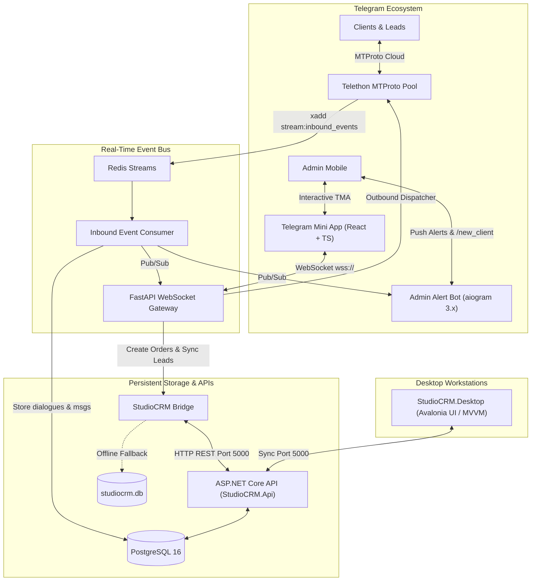

# StudioCRM: Enterprise Multi-Account Telegram CRM & Project Management Platform

A modern, production-grade CRM platform uniting high-performance **desktop client management** (C# / .NET 10 / Avalonia UI) with a distributed **Multi-Account Telegram CRM** and pixel-perfect **Telegram Mini App (TMA)** powered by FastAPI, Telethon MTProto, Redis Streams, and aiogram 3.x.

---

## 🏗️ Architecture Overview



---

## 🌟 Key Capabilities

### 1. Telegram Multi-Account CRM & Telegram Mini App (TMA)
* **Dedicated Account Hub:** Manage 50+ concurrent Telegram accounts with isolated sessions and individual SOCKS5 proxies.
* **1:1 Native Telegram Web Replica:** Dark theme, custom doodle wallpaper, rounded message bubbles with SVG tails, and double checkmarks (`✓✓`).
* **Bidirectional MTProto Sync:** Outbound/inbound real-time typing indicators, cloud message editing, revoke-deletion, and photo caching.
* **In-Chat Deal Engine:** Create orders directly from any Telegram conversation (`💼 Создать заказ`) with instant order number generation (`ORD-2026-XXX`).
* **Clients Contact Directory:** Centralized contact book with revenue metrics, active deals, and instant click-to-chat.
* **Circuit Breakers & Anti-Flood:** Automatic `FloodWait` handling without thread locks, background proxy health checking, and session auto-recovery.

### 2. Admin Alert & Client Intake Bot (`aiogram 3.x`)
* **Instant Inbound Notifications:** Push alerts with direct deep-links (`startapp=chat_{acc}_{peer}`).
* **Interactive `/new_client` FSM:** 5-step interactive intake wizard for rapid client and deal onboarding from mobile.
* **Quick Commands:**
  * `/clients` — View top clients and revenue summary directly in chat.
  * `/sync_24h` — Force-sync inbound Telegram contacts into StudioCRM.
  * `/status` — System gateway and database diagnostic check.

### 3. StudioCRM Desktop & ASP.NET Core API (.NET 10 / Avalonia UI)
* Cross-platform desktop interface for Windows, Linux, and macOS.
* Order stages tracking, services catalog, and financial accounting (invoices, payments, receivables).
* Seamless offline fallback with local SQLite persistence when remote server is unreachable.

---

## 🚀 Quickstart: Ubuntu 24.04 LTS Automated Deployment

Deploy the entire production stack (PostgreSQL, Redis, ASP.NET Core API, FastAPI Telegram Backend, Admin Bot, Nginx) with our interactive setup wizard:

```bash
# 1. Clone repository
git clone https://github.com/rusky21/CRM.git
cd CRM

# 2. Run automated installer
sudo bash install_ubuntu24.sh
```

---

## ⚡ Multi-Server Split Architecture (Server 1: Frontend + Server 2: Backend)

For distributed production setups or low-RAM environments (2GB RAM VPS), use the split deployment scripts:

### Step 1: Deploy Server 2 (Backend, Bot, DB & MTProto Pool)
*Target: VPS with 2GB RAM (Ubuntu 24.04 LTS)*
```bash
git clone https://github.com/rusky21/CRM.git
cd CRM
sudo bash deploy_backend.sh
```
* Automatically creates a 2GB `/swapfile` safeguard to prevent OOM errors.
* Launches `postgres`, `redis`, `backend` (port 8000), and `bot` with strict container memory limits.
* Prints your Server 2 Backend API URL: `http://<SERVER2_IP>:8000`.

### Step 2: Deploy Server 1 (Frontend & Mini App Web Hosting)
*Target: VPS with domain name (Ubuntu 24.04 LTS)*
```bash
git clone https://github.com/rusky21/CRM.git
cd CRM
sudo bash deploy_frontend.sh
```
* Installs Nginx and Certbot.
* Prompts for your domain (e.g. `crm.myagency.com`) and Server 2 URL (`http://<SERVER2_IP>:8000`).
* Configures secure reverse proxy for `/api/` with WebSocket upgrade pass-through (eliminates Mixed-Content and CORS issues).
* Automatically issues Let's Encrypt SSL certificate.
* Prints your official Mini App URL: `https://<YOUR_DOMAIN>/preview.html`.

The script automatically:
1. Validates the Ubuntu 24.04 environment.
2. Installs Docker CE, Docker Compose plugin, and security tools.
3. Guides you through setting up Telegram credentials and bot tokens.
4. Auto-generates cryptographically secure 256-bit AES keys and random database passwords.
5. Configures UFW firewall rules (SSH 22, HTTP 80, HTTPS 443).
6. Builds and boots all 6 Docker containers in background.

---

## 🐳 Docker Compose Stack

| Service | Container Name | Port | Description |
| :--- | :--- | :--- | :--- |
| **PostgreSQL** | `studiocrm_postgres` | `5432` | Relational database for CRM entities, accounts, and chats. |
| **Redis** | `tg_crm_redis` | `6379` | High-throughput event streams (`stream:inbound_events`) and Pub/Sub. |
| **StudioCRM API** | `studiocrm_api` | `5000` | ASP.NET Core REST API serving clients, orders, and finances. |
| **Telegram Backend** | `tg_crm_backend` | `8000` | FastAPI MTProto pool, WebSocket gateway, and CRM bridge. |
| **Admin Bot** | `tg_crm_admin_bot` | - | `aiogram 3.x` alerts and `/new_client` intake daemon. |
| **Nginx** | `tg_crm_nginx` | `80`, `443` | Reverse proxy and Telegram Mini App web server. |

---

## 📱 BotFather Configuration for Mini App

1. Open [@BotFather](https://t.me/BotFather) in Telegram.
2. Send `/newapp` and select your bot (`@YourBotUsername`).
3. **Title:** `StudioCRM Workspace`
4. **Description:** `Multi-Account Telegram Customer Relationship Management`
5. **Short Name:** `app`
6. **Web App URL:** `https://your-domain-or-ip/app/preview.html`
7. Direct launch link: `https://t.me/YourBotUsername/app`

---

## 📂 Repository Structure

```
CRM/
├── StudioCRM.Api/          # ASP.NET Core REST API (port 5000)
├── StudioCRM.Core/         # Domain entities (Order, Client, Payment, ServiceItem)
├── StudioCRM.Data/         # Entity Framework Core context & repositories
├── StudioCRM.Desktop/      # Desktop client (Avalonia UI / MVVM)
├── StudioCRM.Tests/        # Unit & integration test suites
│
├── backend/                # Multi-Account Telegram CRM (FastAPI + Telethon)
│   ├── app/api/v1/         # REST & WebSocket endpoints (accounts, dialogues, orders, clients)
│   ├── app/core/           # Security (AES-256-GCM), Telegram auth, circuit breakers
│   ├── app/models/         # SQLAlchemy models (Account, Dialogue, Message, Order, Proxy)
│   └── app/services/       # MTProto pool manager, CRM bridge, lead sync, event pipelines
│
├── bot/                    # Admin Alert & FSM Intake Bot (aiogram 3.x)
│   ├── handlers/           # /new_client intake FSM, /clients, /sync_24h, /start
│   └── main.py             # Bot runner and Redis Pub/Sub listener
│
├── frontend/               # Telegram Mini App Frontend (React + Vite + TailwindCSS)
│   ├── preview.html        # Interactive standalone Web App preview (port 3000)
│   └── src/components/     # 1:1 Telegram Web chat components, Account Hub, CRM Book
│
├── deploy/                 # Dockerfiles & Nginx reverse proxy configuration
├── scripts/                # Automated verification and testing scripts
├── install_ubuntu24.sh     # Production deployment wizard for Ubuntu 24.04 LTS
└── docker-compose.yml      # Multi-container orchestration stack
```
